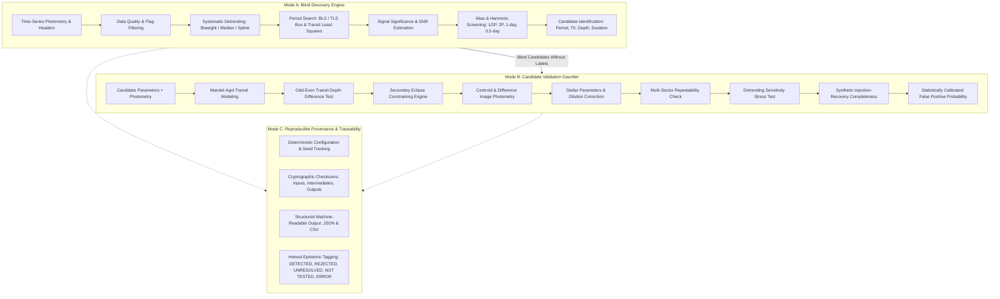

# Scientific Reconstruction Plan & Architectural Blueprint

**Project:** OPERATION PLANETFALL  
**Status:** ACTIVE EXECUTION  
**Author:** Antigravity Autonomous Scientific Architect  
**Date:** 2026-10-25  

---

## 1. The Scientific Contract

PLANETFALL must operate under three strictly partitioned modes with absolute separation of concerns.



### Mode A: Blind Discovery Contract
1. **Zero Prior Knowledge:** The discovery engine ingests raw flux and timestamps $(t_i, f_i, \sigma_i)$ and target coordinates $(\alpha, \delta)$ only. It receives no orbital period, no transit epoch, no candidate classification label, and no known TOI disposition.
2. **Quality & Conditioning:** Mask bad quality flags (TESS default bitmask), clip $>5\sigma$ non-transit outliers, and identify observation cadence and gaps.
3. **Multi-Method Detrending:** Implement robust low-frequency trend removal (windowed biweight filter, median filter, spline) preserving high-frequency transit signals.
4. **Transit Period Search:** Run Box Least Squares (BLS, Kovacs et al. 2002) and Transit Least Squares (TLS, Hippke & Heller 2019) across periods from $0.5$ to $30$ days.
5. **Harmonics & Aliasing:** Explicitly evaluate half-period ($P/2$) and double-period ($2P$) harmonics, orbital aliases, and terrestrial diurnal cycles (1.0 d, 0.5 d).
6. **Feature Extraction:** Accurately measure period $P$, transit midpoint $T_0$, transit depth $\delta = (R_p/R_*)^2$, duration $T_{14}$, ingress/egress duration $T_{12}$, and transit signal-to-noise ratio ($SNR_{transit} = \frac{\delta}{\sigma_{eff}} \sqrt{N_{in}}$).
7. **Ranking & Export:** Export all candidates with machine-readable metadata and diagnostic figures.

### Mode B: Candidate Validation Gauntlet Contract
1. **Adversarial Prosecution:** Assume candidate guilt (impostor hypothesis) until proven otherwise.
2. **Transit Morphology (Mandel-Agol Limb Darkening):** Fit quadratic limb-darkening transit profiles using `batman-package` or non-linear least-squares optimization. Reject V-shaped unphysical depths (>5% in stellar radius ratio for rocky/sub-Neptune targets).
3. **Odd-Even Depth Difference Test:** Fold odd-numbered transits and even-numbered transits separately. Measure $\Delta \delta = |\delta_{odd} - \delta_{even}| / \sqrt{\sigma_{odd}^2 + \sigma_{even}^2}$. If $\Delta \delta > 3\sigma$, candidate is flagged as an Eclipsing Binary (EB).
4. **Secondary Eclipse Search:** Search for flux deficits at phase $\phi \approx 0.5$ (or across eccentric orbits). If secondary depth exceeds $3\sigma$ relative to photometric scatter, flag as self-luminous companion or binary.
5. **Centroid & Contamination Analysis:** Ingest Target Pixel Files (TPF) where available. Compute flux-weighted centroid shifts during in-transit vs out-of-transit epochs. If TPF is unavailable, explicitly report `UNAVAILABLE` or `NOT TESTED`, never `PASS`.
6. **Stellar Parameter Sanity:** Derive physical planet radius $R_p = R_* \sqrt{\delta}$, semi-major axis $a = \left(\frac{G M_* P^2}{4\pi^2}\right)^{1/3}$, and equilibrium temperature $T_{eq} = T_* \left(\frac{R_*}{2a}\right)^{1/2} (1 - A_B)^{1/4}$.
7. **Detrending Invariance:** Verify that transit signal survives across 3 distinct detrending filter widths without significant depth attenuation or parameter drift.
8. **Injection-Recovery Validation:** Inject authentic synthetic limb-darkened transits into the detrended out-of-transit light curve across a 2D grid of period and depth; measure actual recovery rate.

### Mode C: Reproducible Research Contract
1. **Every reported metric must derive from an executable computation.** Zero mock strings, zero canned reports, zero hardcoded candidate IDs.
2. **Missing evidence is reported honestly:** `DETECTED`, `REJECTED`, `UNRESOLVED`, `NOT TESTED`, `ERROR`. Never report `PASS` when data is missing.
3. **Cryptographic hashing:** All retrieved light curves, target pixel files, catalogs, and generated dataframes must have recorded SHA-256 checksums and acquisition timestamps.

---

## 2. Target Architecture: `planetfall.py` and Core Package

### Primary Executable Entry Point: `planetfall.py`
The top-level command-line tool `planetfall.py` provides five production subcommands:
1. `planetfall discover --target TIC_ID [--sector SECTOR] [--outdir DIR]`
2. `planetfall validate --target TIC_ID --period PERIOD --t0 T0 [--depth DEPTH] [--outdir DIR]`
3. `planetfall benchmark --suite SUITE [--outdir DIR]`
4. `planetfall reproduce --target TIC_ID [--outdir DIR]`
5. `planetfall report --results RESULTS_FILE [--outdir DIR]`

### Scientific Module Hierarchy (`src/planetfall/`)
```
src/planetfall/
├── __init__.py                  # Public API exports
├── data/
│   ├── __init__.py
│   ├── acquisition.py           # Lightkurve & MAST TESS downloader with SHA-256 cache
│   ├── lightcurve_cleaner.py    # Quality mask, gap assessment, outlier rejection
│   └── catalog_query.py         # Exoplanet Archive and Gaia DR3 queries
├── engines/
│   ├── __init__.py
│   ├── detrending.py            # Biweight, median, spline filters
│   ├── discovery_engine.py      # BLS and TLS transit search algorithms
│   ├── transit_fitter.py        # Mandel-Agol limb-darkened transit fitting
│   ├── parameter_estimation.py  # Physical parameter derivation with error propagation
│   └── injection_engine.py      # Authentic 2D injection-recovery grid
├── validators/
│   ├── __init__.py
│   ├── oddeven_test.py          # Odd-even depth difference statistical test
│   ├── secondary_eclipse.py     # Secondary eclipse depth constraint
│   ├── centroid_test.py         # TPF centroid shift & difference imaging
│   ├── detrending_sensitivity.py# Preprocessing stability verification
│   └── false_positive.py        # Integrated falsification tribunal
├── reporting/
│   ├── __init__.py
│   ├── publication_plots.py     # Phased transit & periodogram plotting
│   └── casefile_generator.py    # Structured markdown and JSON reports
└── benchmarks/
    ├── __init__.py
    ├── benchmark_suite.py       # 8 independent benchmark execution harnesses
    └── evaluation_metrics.py    # Precision, recall, specificity, FPP
```

---

## 3. Implementation Phasing & Milestones

| Milestone | Subsystem | Target Files | Success Criteria |
|---|---|---|---|
| **M1: Data Acquisition & Preprocessing** | `planetfall/data/` | `acquisition.py`, `lightcurve_cleaner.py` | Query MAST for TESS targets, download 2-min cadence SPOC light curves and TPFs, cache with SHA-256. |
| **M2: Blind Transit Discovery Engine** | `planetfall/engines/` | `detrending.py`, `discovery_engine.py` | Implement BLS search; blind recovery of transits without period inputs. |
| **M3: Transit Modeling & Physics** | `planetfall/engines/` | `transit_fitter.py`, `parameter_estimation.py` | Mandel-Agol limb-darkened fitting with analytical/scipy optimization; physical parameter derivation. |
| **M4: Adversarial Vetting Gauntlet** | `planetfall/validators/` | `oddeven_test.py`, `secondary_eclipse.py`, `centroid_test.py` | Detect odd-even differences >3-sigma in eclipsing binaries; constrain secondary eclipses; measure centroid shifts. |
| **M5: Injection-Recovery Engine** | `planetfall/engines/` | `injection_engine.py` | Real signal injection and recovery measuring empirical recovery fraction across period/depth grid. |
| **M6: Benchmarking Suite (1 to 8)** | `planetfall/benchmarks/`| `benchmark_suite.py` | Run 8 independent benchmarks on real confirmed planets, eclipsing binaries, injections, and blind searches. |
| **M7: CLI Entry Point & Reports** | `planetfall.py` | `planetfall.py`, `casefile_generator.py` | Unified CLI supporting all 5 commands; zero swallowed exceptions; honest epistemic verdicts. |
| **M8: Independent Release & Verification** | Release artifacts | `tests/`, `README.md`, `SCIENTIFIC_METHODS.md`, etc. | 100% test pass rate in clean environment; final acceptance matrix validated. |
